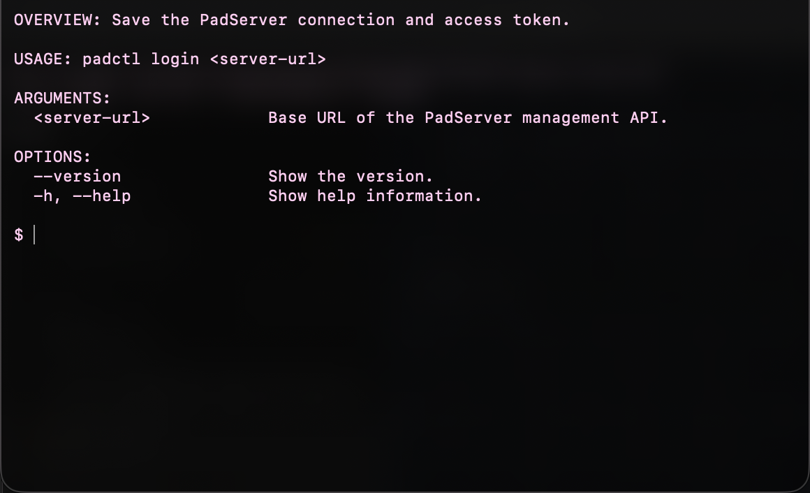

# PadServer

iPad を, 前面に固定したアプリ1つで動くサーバーにします.
静的サイトと, Docker の container で動くサービスを, 独自ドメインで配信します.

部品を実装中です. iPad への配備から公開までの通しの動作には, まだ対応していません.

clone 後に `scripts/bootstrap.sh` を1回実行すると, 開発用ツールが入り, commit hook が有効になります.

## 管理 API の通信型

内部の `PadInterface` は、配備の差分確認と確定、プロジェクトの一覧と開始や停止、ログ1件、エラー応答の JSON 形式を表します。管理 API 自体の接続口は後続の実装で用意します。
日時は UTC の ISO 8601 文字列を秒精度で表し、有効な release が無い場合は `activeRelease: null` を返します。

`swift test --package-path Packages/PadServerCore` の出力から、JSON 例との照合結果を以下に示します。

```text
✔ Test deploymentRequestAndDiffJSONMatchDocumentedExamples() passed
✔ Test deploymentResponseJSONMatchesDocumentedExample() passed
✔ Test projectListJSONMatchesDocumentedExample() passed
✔ Test projectStopJSONMatchesDocumentedExample() passed
✔ Test projectStatusEncodesMissingReleaseAsNull() passed
✔ Test errorJSONMatchesDocumentedExampleAndCodes() passed
✔ Test logEntryUsesUTCISO8601Timestamp() passed
```

## guest の状態と操作 port

内部の `GuestState` は guest の停止、起動中、準備完了、失敗を表します。`GuestController` は状態の取得と起動、停止の操作を呼び出すための port です。QEMU を使った実装は後続の Issue で追加します。

`swift test --package-path Packages/PadServerCore` で状態の JSON 値を確認した出力です。

```text
✔ Test guestStateJSONValuesAreStable(state:wireValue:) with 4 test cases passed
```

## QEMU のソースの取得

`scripts/fetch-qemu.sh` は, tctiSH とその QEMU fork を固定した commit で `build/sources/` に取得します.
同じ script を再実行すると, 取得済みの commit と取得元を確認します. `build/` は git の管理対象から外しています.
QEMU のビルドは, 後続の作業で行います.

2回続けて実行し, commit と git の除外設定を確認した出力です.

```text
$ ./scripts/fetch-qemu.sh
tctiSH 76b6f6081fc328c05c4e0fc1d770aec7f1cdcbc4
qemu ded0cff5a2a6d3b0a5261ab570518719b42ae2e6
$ ./scripts/fetch-qemu.sh
tctiSH 76b6f6081fc328c05c4e0fc1d770aec7f1cdcbc4
qemu ded0cff5a2a6d3b0a5261ab570518719b42ae2e6
$ git check-ignore build/sources/tctiSH build/sources/qemu
build/sources/tctiSH
build/sources/qemu
```

## 管理 token の発行

内部部品の `IssueToken` は, システムの暗号的乱数から32バイトの管理 token を生成して保存します.
再発行すると保存済みの token を置き換えるため, 古い token は照合先ではなくなります.
通常の試験では生成値を固定し, 実 Keychain や乱数に依存せず保存と置換を確認します.

`swift test --package-path Packages/PadServerCore` の実行結果から, 実行時間を省いて掲載します.

```text
✔ Test issueTokenSavesAndReturnsGeneratedToken() passed
✔ Test issueTokenReplacesPreviouslyStoredToken() passed
✔ Test run with 92 tests in 2 suites passed
```

## 設定ファイルの読み取り

CLI 内部の `ManifestLoader` が `padserver.toml` の内容を読み取り, 既存の `ProjectManifest` に変換します.
構文や値に誤りがある場合は, 行番号を含むエラーを返します. 配備コマンドへの接続は後続の実装で行います.

`swift test --package-path cli` では, 正常な設定の変換と, 構文, root, 経路, 空の routes のエラー行を確認しています.

```text
✔ Test decodesManifestAndNormalizesRouteValues() passed
✔ Test reportsSyntaxErrorLine() passed
✔ Test reportsInvalidRootAtItsSourceLine() passed
✔ Test reportsInvalidRouteAtItsSourceLine() passed
✔ Test reportsInvalidPathPrefixAtItsSourceLine() passed
✔ Test reportsTopLevelEmptyRoutesAtItsSourceLine() passed
✔ Test run with 6 tests in 0 suites passed
```

上記は試験出力から実行時間を省いたものです.

## 共有の試験用 port

`PadTestSupport` は, ProjectStorage と SecretStore のメモリ内実装を提供します.
release の準備保存, 検証後の active 切替, project の run state と route の保持, blob の pull stream を試験から共有できます.
secret と管理 token もメモリ内で扱い, 固定の時刻と ID を注入できます.
同じ target の `InMemoryLogBus` は直近 1,000 件を再生し, 購読中の stream に新しいログを配信します.

`swift test --package-path Packages/PadServerCore` で実行した共有 port の試験出力です.

```text
✔ Test sharedSecretStoreSupportsProjectSecretsAndAdminToken() passed after 0.003 seconds.
✔ Test sharedReleaseActivationPreservesOtherProjectsActiveRelease() passed after 0.003 seconds.
✔ Test sharedStorageKeepsProjectsAndRunStatesIndependent() passed after 0.003 seconds.
✔ Test sharedSecretsWithTheSameNameStaySeparateAcrossProjects() passed after 0.003 seconds.
✔ Test sharedProjectStorageStoresProjectsReleasesAndBlobStreams() passed after 0.003 seconds.
✔ Test sharedBlobStreamKeepsIndependentPullCursors() passed after 0.003 seconds.
✔ Test sharedProjectStorageActivatesReleasesOnlyAfterValidation() passed after 0.003 seconds.
✔ Test sharedLogCancellationDoesNotStopOtherSubscribers() passed after 0.004 seconds.
✔ Test sharedRuntimePortsProvideFixedValuesAndReplayThenDeliverLogs() passed after 0.005 seconds.
✔ Test run with 79 tests in 2 suites passed after 0.006 seconds.
```

## 配備の差分確認

内部の `PlanDeployment` は, 送信予定のファイル一覧を保存済み blob と照合し, 未保存のファイル参照を返します.
同じ hash は最初の参照だけを返し, 全て保存済みの場合や空入力では空の一覧を返します.

`swift test --package-path Packages/PadServerCore` の出力から, 対象の試験を抜粋しています. 各試験の実行時間は省いています.

```text
✔ Test planDeploymentOmitsStoredBlobs() passed
✔ Test planDeploymentReturnsEmptyWhenAllBlobsAreStored() passed
✔ Test planDeploymentReturnsEmptyForNoFiles() passed
✔ Test planDeploymentDeduplicatesByBlobAndPreservesFirstReferenceOrder() passed
✔ Test run with 87 tests in 2 suites passed after 0.032 seconds.
```

## 管理用サーバーの待ち受け

`AdminServer.makeApplication` に端末の tailnet IP を `tailnetAddress` として渡すと、管理用サーバーはその IP だけで待ち受けます。tailnet 外の IP は設定時に拒否します。接続元と token の認可は管理用 middleware が担当します。

管理用 router は `AuthorizeAdmin` を受け取ります。全要求の `Authorization: Bearer <token>` を検査し、token が無い場合と無効な場合は 401 を返します。有効な token でも接続元が tailnet 外なら 403 を返します。試験では、header の欠落と不正な形式、無効な token、tailnet 外の接続元を確認しています。

```text
✔ Test adminAuthMiddlewareReturnsUnauthorizedWithoutValidBearerToken() passed
```

実際の端末で待ち受けを確かめるには、次のように端末の tailnet IP を指定します。この試験は指定した IP に接続し、同じ port の localhost には接続できないことを確かめます。

```sh
PADSERVER_TEST_TAILNET_IP=100.x.y.z swift test --package-path Packages/PadServerCore --filter adminServerAcceptsOnlyItsTailnetInterface
```

実行結果の抜粋です。端末の IP と一時 port は伏せています。

```text
Server started and listening on [tailnet IP]:[port]
✔ Test adminServerAcceptsOnlyItsTailnetInterface() passed
✔ Test run with 1 test in 0 suites passed
```

## 管理の認可

内部部品の `AuthorizeAdmin` は、管理 token と接続元から `authorized`、`unauthorized`、`forbidden` を返します。
token が無効または未設定なら `unauthorized`、token が有効でも tailnet 外なら `forbidden` です。
tailnet 内の IPv4 と IPv6 で token が有効なら `authorized` になります。
token の内容は `timingsafe_bcmp` で比較します。

`swift test --package-path Packages/PadServerCore --filter authorizeAdmin` の実行結果です。

```text
✔ Test authorizeAdminRequiresTailnetAddressEvenWithCorrectToken() passed
✔ Test authorizeAdminRejectsMismatchedTokens(supplied:) with 7 test cases passed
✔ Test authorizeAdminRejectsUnconfiguredToken() passed
✔ Test run with 3 tests in 0 suites passed
```

## 文書

| 文書 | 内容 |
| --- | --- |
| [docs/roadmap.md](docs/roadmap.md) | 全体像, 決めたこと, 計画表 |
| [docs/decisions.md](docs/decisions.md) | 決定を決めた順に並べた記録 |
| [ipad-server-feasibility.md](ipad-server-feasibility.md) | iPadOS の制約についての調査メモ |
| [docs/pull-requests.md](docs/pull-requests.md) | PR の作り方と, merge の規則. 全ての PR で README を更新する |
| [AGENTS.md](AGENTS.md), [CLAUDE.md](CLAUDE.md) | merge 係の手順と, Codex との連絡の規則 (同じ内容) |

配備の実装では、[docs/admin-api.md](docs/admin-api.md) の例に従い、`ProjectManifest.root` からの相対 path を指定できます。`root` が `dist` の場合、`dist/index.html` の送信 path は `index.html` です。次の JSON は修正した配備例の抜粋です。

```json
{"manifest":{"root":"dist"},"files":[{"path":"index.html"}]}
```

## プロジェクトの一覧と状態

内部部品の `ListProjects` は, プロジェクトごとに種類, 有効な release, 動いているかを返します.
preparing と retired の release を有効な release として返さず, release が無い場合は `nil` を返します.
静的サイトと container の種類を保ち, 開始状態と停止状態も区別します.

`swift test --package-path Packages/PadServerCore` の実行結果から, 実行時間を省いて掲載します.

```text
✔ Test listProjectsReturnsEmptyListWhenNoProjectsExist() passed
✔ Test listProjectsReturnsKindActiveReleaseAndRunningStatePerProject() passed
✔ Test run with 92 tests in 2 suites passed
```

## blob の保存

内部部品の `FileBlobStore` は, body を小分けに一時ファイルへ書き, CryptoKit の SHA-256 で照合します.
hash は小文字16進64桁とし, 一致した内容だけを hash の名前で公開します.
不一致や受信中断の一時データを破棄し, 同じ内容は1つだけ保存します.
読み出しも小分けに行い, 繰り返し開いた stream はそれぞれ独立して読み進められます.
hash 名のシンボリックリンクを拒否し, 最初の読み出し前にリンクへ差し替えられても追跡しません.
`ProjectStorage.blobSize` は、blob の中身を読み込まずにファイルの大きさをバイト数で返します。存在しない blob とシンボリックリンクは `nil` です。ファイルを読み取れない権限にした試験でも、大きさを取得できます。

`swift test --package-path Packages/PadServerCore --filter fileBlobStore` の実行結果から, 実行時間を省いて掲載します.

```text
✔ Test fileBlobStoreDiscardsMismatchedContentAndTemporaryFile() passed
✔ Test fileBlobStoreRejectsHashNamedSymbolicLink() passed
✔ Test fileBlobStoreWritesStreamingBodyUnderItsSHA256Name() passed
✔ Test fileBlobStoreAcceptsEmptyBlobAndStreamsEndImmediately() passed
✔ Test fileBlobStoreReadsLargeBlobInBoundedChunks() passed
✔ Test fileBlobStoreDoesNotDuplicateExistingContent() passed
✔ Test fileBlobStoreDiscardsInterruptedReceiveAndAllowsRetry() passed
✔ Test fileBlobStoreRejectsLinkReplacementBeforeFirstPull() passed
✔ Test fileBlobStoreOpensIndependentStreamsAndListsAndRemovesBlob() passed
✔ Test fileBlobStoreReportsSizeWithoutReadingBlob() passed
✔ Test run with 10 tests in 0 suites passed
```

## ログの配信

内部部品の `InMemoryLogBus` は, 複数の購読者にログを流します.
後から接続した購読者には直近1,000件を先に渡し, その後のログも渡します.
購読者ごとの未読ログも最大1,000件とし, 遅い購読者の古い未読ログを捨てることで, 他の購読者を止めません.

`swift test --package-path Packages/PadServerCore` で確認した出力から, 実行時間を省いて掲載します.

```text
✔ Test replaysOnlyTheLatestThousandEntriesInPublishOrder() passed
✔ Test publishesEachEntryToMultipleSubscribers() passed
✔ Test slowSubscriberDropsOldBufferedEntriesWithoutBlockingAnotherSubscriber() passed
✔ Test cancelledSubscriberDoesNotBlockOtherSubscribers() passed
✔ Test publishAtTheReplayBoundaryIsDeliveredExactlyOnceAndInOrder() passed
```

## QEMU の起動引数

`PadGuest` の `QEMUArguments` は, メモリ, CPU 数, kernel, initrd, disk, network の設定から QEMU の引数を組み立てます.
引数の並びは, 検証で使った tctiSH の実機向け起動コードに合わせています. QEMU の起動自体は後続の作業です.
guest disk は `-drive` の `format=raw` で raw 形式として読み込みます。これは #126 の raw 疎ファイルと形式をそろえるためです。

`GuestDisk.createIfNeeded(sizeBytes:)` は、指定した容量の raw 疎ファイルを Application Support 内の `PadServer/GuestDisk` に初回だけ作ります。この専用ディレクトリはバックアップの対象から外します。2回目は既存の disk をそのまま返すため、保存済みの内容と容量を保ちます。

`swift test --package-path Packages/PadGuest` で、疎ファイル、バックアップの除外、2回目の保持を確認した出力です。

```text
✔ Test guestDiskDoesNotReplaceExistingFileOnSecondLaunch() passed after 0.011 seconds.
✔ Test guestDiskCreatesSparseRawFileOutsideBackup() passed after 0.012 seconds.
✔ Test run with 7 tests in 0 suites passed after 0.012 seconds.
```

`swift test --package-path Packages/PadGuest` で並びを照合した出力です.

```text
✔ Test qemuArgumentsMatchIPadLauncherOptionOrder() passed after 0.001 seconds.
✔ Test packageNamespaceIsAvailableToConsumers() passed after 0.001 seconds.
✔ Test run with 2 tests in 0 suites passed after 0.001 seconds.
```

`format=raw` を含む引数の試験結果です。

```text
✔ Test qemuArgumentsMatchIPadLauncherOptionOrder() passed after 0.001 seconds.
```

## QEMU monitor の操作

`PadGuest` の `QEMUMonitor` は、端末内の HMP `localhost:10045` に接続して VM の状態を取得します。guest の通常停止には `system_powerdown` を送り、強制終了には `quit` を送ります。port 転送は `hostfwd_add` と `hostfwd_remove` で操作し、追加後は `info usernet` で反映を確認します。`stop` による一時停止と、停止を待って強制終了へ切り替える処理は含めません。

`swift test --package-path Packages/PadGuest --filter qemuMonitor` で、ローカルの偽 HMP サーバーが受け取ったコマンドと返答の処理を確認した結果です。

```text
✔ Test qemuMonitorReportsPausedStateAndCommandFailure() passed
✔ Test qemuMonitorRejectsUninstalledPortForward() passed
✔ Test qemuMonitorSendsHMPCommandsToLoopback() passed
✔ Test run with 3 tests in 0 suites passed
```

## ライセンス

MIT です. [LICENSE](LICENSE) にあります.

## プロジェクトの開始と停止

内部部品の `SetProjectState` は, プロジェクトの開始状態と停止状態を保存します.
停止すると `ResolveRoute` は配信先を返さず停止中として扱い, 再開すると元の経路が解決されます.
保存先が返すエラーは呼び出し側へ伝え, 別のプロジェクトの状態を変更しません.

`swift test --package-path Packages/PadServerCore` の実行結果から, 実行時間を省いて掲載します.

```text
✔ Test setProjectStateStopsRouteResolutionAndRestoresItOnStart() passed
✔ Test setProjectStatePropagatesUnknownProjectFailureWithoutChangingOtherProjects() passed
✔ Test run with 108 tests in 2 suites passed
```

## Keychain への保存

内部部品の `KeychainSecretStore` が, 管理 token とプロジェクト別の secret を Mac と iOS の Keychain に保存します.
通常の試験はメモリ内の代替実装を使い, 実 Keychain に触れません.

Mac で実 Keychain を確認する結合試験は, 明示して実行します.
この試験は一意な project 名の一時項目を作り, 保存, 取得, 更新, 一覧, 削除を確認して片付けます.
既存の管理 token は使いません.

```sh
PADSERVER_KEYCHAIN_INTEGRATION=1 swift test --package-path Packages/PadServerCore --filter KeychainSecretStoreIntegrationTests
```

実際の実行結果です.

```text
✔ Test storesReadsUpdatesListsAndDeletesInRealKeychain() passed after 0.072 seconds.
✔ Suite KeychainSecretStoreIntegrationTests passed after 0.072 seconds.
✔ Test run with 1 test in 1 suite passed after 0.072 seconds.
```

## プロジェクトごとの secret 管理

内部部品の `ManageSecrets` は、プロジェクトごとに secret の値を設定し、名前の一覧を返し、指定した secret を削除します。
一覧には値を含めず、同じ名前を別のプロジェクトで使っても内容を分けます。

`swift test --package-path Packages/PadServerCore --filter manageSecrets` の出力です。

```text
✔ Test manageSecretsRemovesOnlyNamedProjectSecret() passed after 0.001 seconds.
✔ Test manageSecretsKeepsValuesPerProjectAndListsOnlyNames() passed after 0.001 seconds.
✔ Test run with 2 tests in 0 suites passed after 0.001 seconds.
```

## 古い release の掃除

内部部品の `PruneReleases` は, プロジェクトごとに保存順で直近3つの release を残します.
有効な release は, 直近3つより古くても必ず残します.
残す release の manifest を全プロジェクトについて確認し, どこからも参照されない blob を削除します.
別プロジェクトと共有する blob は残ります.

`swift test --package-path Packages/PadServerCore` の実行結果から, 実行時間を省いて掲載します.

```text
✔ Test pruneReleasesKeepsLatestThreeForEachProjectInStorageOrder() passed
✔ Test pruneReleasesAlwaysKeepsActiveReleaseOutsideLatestThree() passed
✔ Test pruneReleasesRemovesOnlyBlobsUnreferencedByRetainedReleases() passed
✔ Test pruneReleasesHandlesEmptyStorageAndFewerThanThreeReleases() passed
✔ Test run with 101 tests in 2 suites passed
```

## プロジェクト一覧の保存

内部部品の `FileProjectRepository` は, プロジェクト一覧を JSON ファイルに保存して読み込みます.
保存時は同じディレクトリの一時ファイルを完成させてから rename するため, 書き込みの途中や rename の失敗時にも, 保存済みの一覧を読み取れます.
通常の試験は一時ディレクトリ内のファイルだけを使い, JSON の読み書きと, 書き込み中断および rename 失敗後に既存の一覧が保たれることを確認します.

`swift test --package-path Packages/PadServerCore --filter FileProjectRepositoryTests` の実行結果です.

```text
✔ Test preservesExistingProjectsWhenRenameFails() passed
✔ Test rejectsCorruptJSON() passed
✔ Test preservesExistingProjectsWhenTemporaryWriteStopsEarly() passed
✔ Test readsEmptyListWhenFileDoesNotExistAndPersistsProjects() passed
✔ Test run with 4 tests in 0 suites passed after 0.010 seconds.
```

## 配備の確定

内部部品の `CommitDeployment` は, manifest にある全 blob を確認して release を保存し, active release を切り替えます.
blob が欠けている場合や release の保存が失敗した場合は, それまでの active release を保ちます.
成功時は新しい release が active になり, 以前の release は retired になります.

`swift test --package-path Packages/PadServerCore` の実行結果から, 実行時間を省いて掲載します.

```text
✔ Test commitDeploymentActivatesNewReleaseAndRetiresOldRelease() passed
✔ Test commitDeploymentRejectsMissingBlobWithoutChangingActiveRelease() passed
✔ Test commitDeploymentPropagatesReleaseSaveFailureWithoutChangingActiveRelease() passed
✔ Test run with 90 tests in 2 suites passed
```

## 経路の解決

内部部品の `ResolveRoute` は, host とパスからプロジェクトと配信先を返します.
サブドメインとパスによる振り分けに対応し, 一致するパスの prefix が最も長い経路を選びます.
停止中のプロジェクトと, 該当する経路が無い場合を区別します.
停止した経路に一致した要求を, 短い prefix の別プロジェクトに振り替えません.
同じ host で最長の prefix の経路が複数ある場合は, どれにも解決せず拒否します.

`swift test --package-path Packages/PadServerCore` の実行結果から, 実行時間を省いて掲載します.

```text
✔ Test resolveRouteMatchesSubdomainAndPreservesTarget() passed
✔ Test resolveRouteChoosesLongestPathPrefix() passed
✔ Test resolveRouteDistinguishesStoppedProjectFromUnmatchedRoute() passed
✔ Test resolveRouteReturnsNotFoundForUnmatchedPathAndEmptyRoutes() passed
✔ Test resolveRouteRejectsAmbiguousLongestPrefixWithoutBlockingMoreSpecificRoute() passed
✔ Test run with 102 tests in 2 suites passed
```

### 経路の重複の検出

`RegisterProjectRoutes` は、登録する経路の host とパスの prefix が既存の別プロジェクトの経路、または同時に登録する経路と重なる場合に拒否します。保存側で検査と更新を一つの操作として行うため、並行登録でも重複を残しません。拒否時は既存の経路とプロジェクトを変更しません。host または prefix が違う経路は登録できます。

`swift test --package-path Packages/PadServerCore --filter registerProjectRoutes` の実行結果です。

```text
✔ Test registerProjectRoutesAcceptsDistinctHostOrPrefix() passed
✔ Test registerProjectRoutesRejectsDuplicatesWithinOneRegistration() passed
✔ Test registerProjectRoutesRejectsDuplicateAcrossProjectsWithoutChangingExistingRoutes() passed
✔ Test registerProjectRoutesRejectsOneOfTwoConcurrentDuplicates() passed
✔ Test run with 4 tests in 0 suites passed
```

### release と manifest のファイル保存

`FileReleaseStore` は release と manifest を保存し、再起動後も読み出せます。
同じプロジェクトの旧 active を retired にする変更と、新しい active への変更を、
一つの JSON の原子的置換で保存します。保存に失敗した場合、旧 active が残ります。
保存した順序を保ち、release の削除では対応する manifest も削除します。
project と blob の存在確認は、ProjectStorage の組み立て側が担当します。

確認には、一時ディレクトリでの保存と再読み込み、プロジェクト別の切り替え、
保存エラー時の状態維持を含む試験を使います。

```text
$ swift test --package-path Packages/PadServerCore --filter fileReleaseStore
✔ Test run with 6 tests in 0 suites passed after 0.017 seconds.
```

### ProjectStorage のファイル保存

`FileProjectStorage` は project、経路、実行状態、release、blob の保存部品を束ねます。
project の登録時には host と prefix の重複を確認し、登録内容を一つの JSON ファイルで置き換えます。
release の切り替え前には project と manifest 内の全 blob の存在を確認します。
検証で拒否した場合は旧 active を保ち、成功した場合は旧 active が retired になります。
切り替えと blob の削除が同時に来た場合は、後から来た操作を拒否します。

`swift test --package-path Packages/PadServerCore --filter fileProjectStorage` の実行結果です。

```text
✔ Test fileProjectStorageRejectsDuplicateRoutesWithoutChangingRegistration() passed
✔ Test fileProjectStorageRejectsMissingProjectWithoutSwitchingActiveRelease() passed
✔ Test fileProjectStoragePersistsProjectsRoutesAndRunState() passed
✔ Test fileProjectStorageValidatesBlobsBeforeSwitchingActiveRelease() passed
✔ Test run with 4 tests in 0 suites passed
```

### CLI の接続先と token の保存

`padctl login <server-url>` で、管理 API の接続先と token を保存できます。
token は端末で非表示の入力を受け付け、Mac の Keychain に保存します。
`~/.config/padctl/config.json` には `serverURL` を保存し、必要なら `deviceID` も指定できます。token はこのファイルに保存しません。
URL に埋め込んだ認証情報は拒否します。保存が失敗した場合、以前の設定と token に戻します。

実機の端末 ID を使う場合は、利用者が `~/.config/padctl/config.json` を編集し、省略可能な `deviceID` を加えます。`padctl login` を再実行してもその値は残ります。

```json
{"serverURL":"https://pad.example.com","deviceID":"example-device-id"}
```

`swift test --package-path cli --filter loginPreservesDeviceIDEditedInConfigFile` で、編集後に login しても ID が残ることを確認した結果です。

```text
✔ Test loginPreservesDeviceIDEditedInConfigFile() passed
✔ Test run with 1 test in 0 suites passed
```

```sh
swift run --package-path cli padctl login https://pad.example.com
```

新しく追加したコマンドなので、変更前の画面はありません。
次の画面は `padctl login --help` を実際の端末で実行したものです。



通常の試験は実 Keychain に触れません。結合試験は専用の一時項目で、保存と更新、
設定ファイルに token が入らないことを確認し、作成した項目を削除します。

```text
$ PADCTL_KEYCHAIN_INTEGRATION=1 swift test --package-path cli
✔ Test run with 19 tests in 0 suites passed after 0.079 seconds.
```

### iPad アプリの入れ直し

`padctl reinstall` は repo の直下で実行します。設定ファイルの `deviceID` は利用者が編集して指定します。コマンドは `xcodegen` で Xcode project を生成し、scheme `PadServer` の `Debug` を実機向けにビルドして、`xcrun devicectl` でその端末へ `PadServer.app` を入れ直します。ビルド成果物は一時ディレクトリに置き、処理後に削除します。

```sh
swift run --package-path cli padctl reinstall
```

外部コマンドを記録する試験で、コマンドの順序、指定する端末 ID、ビルド成果物の path を確認しています。実機での入れ直しは M2-54 で確認します。

```text
✔ Test reinstallCommandIsRegistered() passed
✔ Test reinstallBuildsAndInstallsAppForConfiguredDevice() passed
✔ Test reinstallRequiresDeviceIDBeforeRunningCommands() passed
```

### loopback の配信入口

`ServingServer` は Hummingbird を `127.0.0.1` だけで待ち受けるよう構成します。
要求の authority とパスを `ResolveRoute` に渡し、一致した経路と要求をハンドラーへ渡します。
最長の経路が停止中なら 503 を返し、一致しない経路と曖昧な経路には 404 を返します。
入口では本文を読み込みません。静的ファイルの応答と container への転送は、後続の実装で接続します。

待ち受け設定と、ネットワークを使わない Hummingbird の試験で動作を確認しています。
試験では、経路の境界、停止中の経路、authority の正規化、要求本文の受け渡しも確認します。

```text
$ swift test --package-path Packages/PadServerCore --filter servingServer
✔ Test run with 7 tests in 0 suites passed after 0.006 seconds.
```

### 有効な release の静的ファイル応答

`StaticFileResponder` は経路に対応する有効な release の manifest からファイルを探し、
blob を読みながら応答します。公開ルートからの相対 path を使い、`/` は `index.html` に対応します。
`Content-Type` と `ETag` を返し、一致する `If-None-Match` には 304 を返します。
親ディレクトリへ出る path と見つからないファイルには 404 を返します。

単一の `Range: bytes=...` には、保存済み blob の全長から選んだ部分を 206 で返します。範囲を満たせない場合は `Content-Range: bytes */<全長>` と 416 を返します。複数 range は無視して 200 で全文を返します。部分応答も blob の stream から小分けに読みます。

経路の prefix、条件付き応答、親ディレクトリを指定する path と Range の応答を試験で確認しました。

```text
$ swift test --package-path Packages/PadServerCore --filter staticFileResponder
✔ Test staticFileResponderServesSingleByteRanges() passed
✔ Test staticFileResponderRejectsUnsatisfiableRange() passed
✔ Test staticFileResponderIgnoresMultipleRanges() passed
✔ Test staticFileResponderRejectsRangeForEmptyBlob() passed
✔ Test staticFileResponderRejectsParentSegments(path:) with 4 test cases passed
✔ Test staticFileResponderUsesRoutePrefixAndManifestRelativePath() passed
✔ Test staticFileResponderServesActiveRootIndexAndConditionalResponse() passed
✔ Test run with 8 tests in 0 suites passed
```

### relay の CI 試験

PR と main への push では、CI の `relay` job が依存を固定した lockfile から入れ、
型チェックと relay の試験を実行します。relay の変更を PR 上で検査できます。

同じコマンドをローカルで実行した結果です。

```text
$ bun install --frozen-lockfile
42 packages installed [5.78s]
$ bun run typecheck
$ tsc --noEmit
$ bun test
1 pass
0 fail
1 expect() calls
Ran 1 test across 1 file. [18.00ms]
```

### 配信要求の記録

配信入口は要求ごとに、時刻、host、パス、応答 status、所要時間をログ bus に流します。
一致した経路の応答と、経路が見つからない 404 の両方を記録します。
ハンドラーが失敗して 500 を返す場合も記録します。

実際の配信入口を通す試験で、ログの内容を確認しました。

```text
$ swift test --package-path Packages/PadServerCore --filter requestLogMiddleware
✔ Test requestLogMiddlewarePublishesResponseAndMissingRoute() passed after 0.004 seconds.
✔ Test requestLogMiddlewarePublishesFailedRequestStatus() passed after 0.004 seconds.
✔ Test run with 2 tests in 0 suites passed after 0.004 seconds.
```
